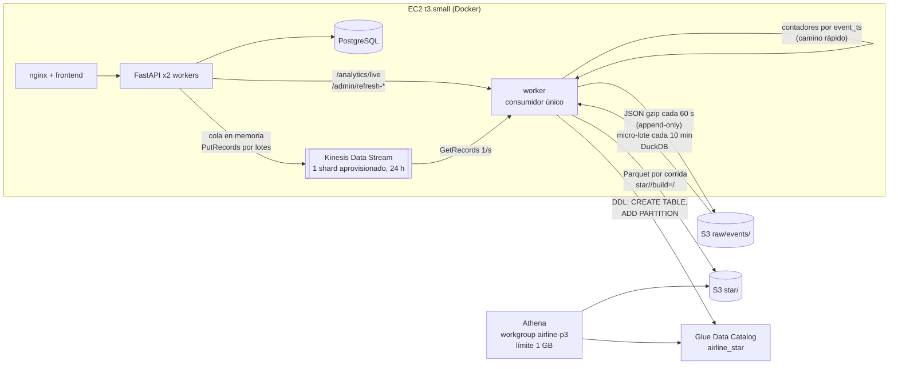
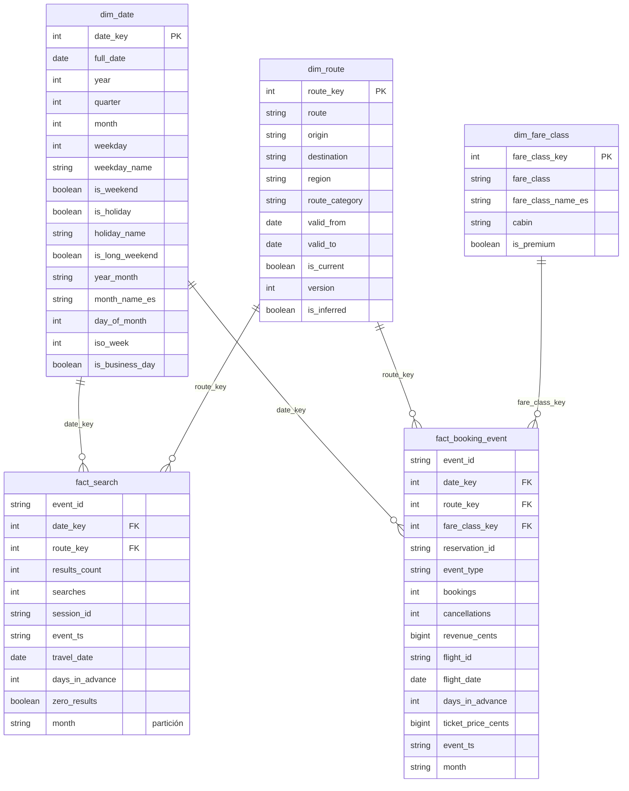

# Parcial 3: eventos, vista en vivo y esquema estrella

Sistema de reservas de la aerolínea regional (Big Data e Ingeniería de Datos, 2026-2).
Este documento cubre las secciones 5 (decisiones y justificación) y 6 (ejecución del harness) del enunciado,
la guía de despliegue y el apéndice del registro de prompts.

**Resumen de la solución.** El backend publica cada búsqueda, reserva y cancelación en un stream de Kinesis
de **un shard aprovisionado**. Un único proceso **worker** lee el stream y hace dos cosas con la misma lectura:
lleva contadores en memoria por `event_ts` para `GET /analytics/live` (camino rápido, segundos) y escribe los
registros tal cual en la **landing zone** de S3 cada 60 s (camino analítico). Cada 10 minutos (o con
`POST /admin/refresh-star`) el mismo worker reconstruye el **esquema estrella** con DuckDB: deduplica,
asigna fechas por `event_ts`, resuelve la versión SCD2 de la ruta vigente en la fecha del evento, escribe Parquet
en S3 y registra las tablas y particiones en el Glue Data Catalog con DDL de Athena. Los analistas consultan
con Athena, en un workgroup limitado a 1 GB por consulta.

| Componente | Dónde vive en el repositorio |
|---|---|
| Publicador de eventos (asíncrono, por lotes) | `app/events/publisher.py`, `app/events/schema.py` |
| Endpoints nuevos (cancelar, live, refresh) | `app/api/contract.py`, `app/crud/crud_contract.py` (`cancelar`) |
| Worker: consumidor, vista en vivo, landing | `app/worker/consumer.py`, `live.py`, `landing.py`, `main.py` |
| ETL de la estrella | `app/star/sql.py` (SQL), `app/star/etl.py` (orquestación, Parquet, Glue) |
| Scripts AWS | `aws/p3/stream.sh` (crear/borrar stream), `setup.sh`, `generate_ref.sh`, `reset.sh`, `run_harness.sh` |
| Harness en local (sin AWS) | `local_harness_p3/` |
| Proyección de costos | `cost_projection.yaml` |

---

## Arquitectura



Versión en texto (por si el visor no muestra Mermaid):

```
 cliente ─► nginx ─► FastAPI ──commit──► PostgreSQL
                       │  encola (µs)
                       ▼
              hilo publicador ──PutRecords (≤500)──► Kinesis (1 shard)
                                                        │ GetRecords 1/s
                                                        ▼
                                               worker (consumidor único)
                                      ┌─────────────────┴──────────────────┐
                       contadores por event_ts                 buffer ─► S3 raw/events/*.json.gz  (≤ 60 s)
                       GET /analytics/live (≤ 2 s)                                │
                                                          cada 10 min / POST /admin/refresh-star
                                                                                  ▼
                                               DuckDB: dedup ─► dims ─► SCD2 as-of ─► hechos
                                                                                  ▼
                                      S3 star/<tabla>/build=<id>/*.parquet  +  Glue (DDL vía Athena)
                                                                                  ▼
                                                                   Athena (workgroup airline-p3, 1 GB)
```

---

## 5. Decisiones y justificación

Cada decisión cita el requisito (R1-R12) y los pilares del AWS Well-Architected Framework: Excelencia
operacional (EO), Seguridad (SEG), Fiabilidad (FIA), Eficiencia del rendimiento (REN), Optimización de
costos (COS) y Sostenibilidad (SOS).

### 5.1 Qué entra al stream y qué no

**Búsquedas.** Encajan en Kinesis: son muchas (~85 % de los eventos), pequeñas (~300 B), no tienen valor
individual y perder unas pocas no cambia ninguna decisión de negocio. Por eso se publican en modo
*best-effort*: el endpoint solo encola el evento en memoria (microsegundos) y un hilo las envía en lotes de
hasta 500 con `PutRecords`. Si Kinesis falla, cada búsqueda se reintenta hasta 6 veces y después se descarta
(se cuenta en `GET /admin/events-stats`). La búsqueda nunca espera a Kinesis. **R1, R2; REN, FIA.** En local, la
ráfaga de 200 búsquedas con 50 concurrentes tuvo p95 = 0,02-0,04 s y los 200 eventos llegaron al stream.

**Reservas y cancelaciones.** Son delicadas porque son transacciones de negocio: un evento perdido es un
ingreso que falta en la estrella. Hay además un problema de *doble escritura*: la reserva se guarda en
PostgreSQL y el evento va a Kinesis, y no existe una transacción que cubra ambos. Lo que hicimos:
- se publica **después del commit** (nunca se anuncia una reserva que no quedó guardada);
- van a una cola de **críticos** sin tope que se reintenta con backoff hasta que Kinesis la acepta (nunca se
  descartan mientras el proceso viva);
- la clave de partición es `flight_id`, así la creación y la cancelación de un mismo vuelo quedan en el mismo
  shard y en orden;
- no llevan datos personales: el nombre del pasajero queda solo en PostgreSQL (**SEG**: minimización).

Qué se puede perder sin daño: búsquedas (afecta un poco la conversión, que es una tasa). Qué no se puede
perder: reservas y cancelaciones (afectan los ingresos de Q1, Q4 y Q5).

**En producción (descrito, no implementado): patrón *transactional outbox*.** En la misma transacción que
inserta la reserva se inserta una fila en una tabla `outbox(event_id, payload, created_at, sent_at)`. Si el
commit ocurre, el evento existe; si no, tampoco. Un proceso *relay* lee las filas con `sent_at IS NULL`, las
publica con `PutRecords` y marca `sent_at`. Si se cae entre publicar y marcar, vuelve a publicar el mismo
`event_id` (al menos una vez), y el ETL deduplica por `event_id`. La alternativa sin tabla extra es CDC sobre el
WAL de PostgreSQL (Debezium o AWS DMS). Hoy, si el proceso de la API muere con eventos críticos en la cola
(ventana de ~200 ms), se perderían: es el riesgo que el outbox elimina. **FIA.**

### 5.2 Dos caminos: vista en vivo y estrella

**La vista en vivo lee el stream y no Athena** porque Athena es un motor por lotes: cada consulta tarda
segundos en arrancar, solo ve lo que ya está en S3 (hasta 60 s de retraso de la landing más el siguiente
refresco de la estrella) y factura un mínimo de 10 MB por consulta. Si el panel consultara Athena cada 5 s
serían 17.280 consultas/día × 10 MB = 173 GB/día ≈ **US$0,86/día (~US$26/mes)** solo por mirar un contador. El
consumidor lee el stream una vez por segundo y mantiene un arreglo de contadores por segundo de `event_ts`:
responder es sumar ≤ 3.600 entradas en memoria. En local, los eventos nuevos aparecen en la vista en ~1 s
(el límite es 10 s). Cuenta por **hora del evento**: el replay del harness, con fechas de 2025, se ignora por
completo (después de reinyectar 17.000 búsquedas viejas, la vista siguió mostrando solo las ~240 búsquedas
reales de las pruebas anteriores). **R3; REN, COS.**

Un detalle de diseño: un shard admite **5 llamadas GetRecords/s compartidas** entre todos los lectores. Por
eso hay un único lector (el worker) que alimenta la vista en vivo y la landing a la vez, a 1 llamada/s, y deja
margen para el harness (que lee hasta 4/s). Con dos lectores propios más Firehose estaríamos al límite y
aparecerían errores de *throughput*. **FIA, REN.**

**La estrella se refresca cada pocos minutos y no por evento** porque está hecha para analizar, no para
actualizarse fila a fila:
- Parquet es inmutable: escribir por evento genera un archivo de ~1 KB por evento (el problema de los
  archivos pequeños). Athena paga por archivo abierto y por bytes, y las consultas se vuelven lentas.
- Glue no tiene transacciones: un lector a mitad de una actualización vería un estado parcial.
- La deduplicación y el as-of join necesitan ver todo el conjunto; por evento habría que consultar la
  dimensión y los hechos ya escritos en cada inserción.
- Los eventos tardíos obligarían a reescribir particiones viejas una y otra vez.

Un micro-lote cada 10 minutos agrupa miles de eventos en pocos archivos grandes, hace cada corrida idempotente
y sigue cumpliendo la necesidad del negocio (análisis por día, mes y ruta). **R8; REN, SOS.**

### 5.3 Landing zone: de Kinesis a S3

Elegimos **nuestro propio consumidor** (el mismo worker), no Firehose:

| | Consumidor propio (elegido) | Amazon Data Firehose |
|---|---|---|
| Costo | US$0 adicional (corre en el EC2 que ya pagamos) | US$0,029/GB ingerido, con cada registro redondeado a 5 KB: 20.000 eventos ≈ 0,1 GB ≈ US$0,003 por replay; ~0,8 GB/mes ≈ US$0,02/mes |
| Latencia | ≤ 60 s (configurable, `LANDING_FLUSH_SECONDS`) | buffer de 60-900 s |
| Lecturas del shard | comparte la misma lectura con la vista en vivo | otro lector más contra el límite de 5 GetRecords/s |
| Operación | la mantenemos nosotros (checkpoint en disco) | administrada |
| IAM en Learner Lab | rol de la instancia | requiere un rol de entrega (LabRole) |

El costo de Firehose es despreciable; la razón de peso es la **cuota de lectura del shard** y que la vista en
vivo igual necesita un consumidor. Garantía: **al menos una vez**. El checkpoint (última secuencia escrita en
S3) se guarda en disco *después* de cada objeto; si el worker se cae, relee desde ahí y puede repetir
registros, que el ETL deduplica. Si el stream se borra y se recrea (lo hacemos cada día por costo), el worker
lo detecta por la fecha de creación y lee desde `TRIM_HORIZON`. Los objetos son `raw/events/<UTC>Z-<uuid>.json.gz`,
JSON por línea, inmutables y en orden de llegada. En local, los 19.912 eventos distintos del replay estaban en
S3 a los 15 s (el límite es 300 s). **R4; FIA, COS.**

### 5.4 Diseño del esquema estrella

Partimos de las preguntas de negocio de la sección 4.3. Para cada una: la medida, el hecho y las dimensiones.

| Pregunta | Medida | Hecho | Dimensiones (atributo usado) |
|---|---|---|---|
| Q1 Ingreso neto por mes y clase | `SUM(revenue_cents)` | fact_booking_event | dim_date (year, month), dim_fare_class (fare_class) |
| Q2 Reservas, cancelaciones y tasa por ruta | `SUM(bookings)`, `SUM(cancellations)` | fact_booking_event | dim_route (route) |
| Q3 Reservas por día de la semana | `SUM(bookings)` | fact_booking_event | dim_date (weekday_name) |
| Q4 Top 10 rutas por ingreso neto | `SUM(revenue_cents)` | fact_booking_event | dim_route (route) |
| Q5 Ingreso por mes y categoría vigente | `SUM(revenue_cents)` | fact_booking_event | dim_route SCD2 (route_category de la versión), dim_date (month) |
| Q6 Búsquedas vs reservas por ruta | `SUM(searches)`, `SUM(bookings)` | fact_search + fact_booking_event | dim_route (route) |
| Q7 Festivos vs otros días | `SUM(searches)`, `SUM(bookings)` | fact_search + fact_booking_event | dim_date (is_holiday) |
| Q8 Reservas en puentes festivos | `SUM(bookings)` | fact_booking_event | dim_date (is_long_weekend) |

**Matriz bus** (✓ = el hecho usa la dimensión para esa pregunta):

| Pregunta / Hecho | dim_date | dim_route | dim_fare_class |
|---|:-:|:-:|:-:|
| Q1 fact_booking_event | ✓ month | | ✓ |
| Q2 fact_booking_event | | ✓ | |
| Q3 fact_booking_event | ✓ weekday_name | | |
| Q4 fact_booking_event | | ✓ | |
| Q5 fact_booking_event | ✓ month | ✓ SCD2 | |
| Q6 fact_search | | ✓ | |
| Q6 fact_booking_event | | ✓ | |
| Q7 fact_search | ✓ is_holiday | | |
| Q7 fact_booking_event | ✓ is_holiday | | |
| Q8 fact_booking_event | ✓ is_long_weekend | | |
| **fact_search (todas)** | ✓ | ✓ | — |
| **fact_booking_event (todas)** | ✓ | ✓ | ✓ |

**Dimensiones conformadas:** `dim_date` y `dim_route` son compartidas por los dos hechos con las mismas claves.
Eso es lo que permite Q6 y Q7 (comparar búsquedas con reservas sin unir los hechos entre sí: se agrega cada
uno por la dimensión común y se cruzan los resultados). `dim_fare_class` solo aplica a reservas (una búsqueda
no tiene clase).

**Granos:**
- `fact_search`: una fila por **evento de búsqueda distinto** (`event_id`). Particionada por `month`
  (`YYYY-MM` del `event_ts`), así una consulta de un mes lee solo esa carpeta.
- `fact_booking_event`: una fila por **evento de reserva distinto** (creación o cancelación). Es un grano
  transaccional: la cancelación es una fila aparte con `cancellations = 1` y `revenue_cents` negativo, y así
  `SUM(revenue_cents)` es directamente el ingreso neto, fechado el día en que ocurrió cada evento.



**Atributos que agregamos más allá del contrato, y por qué:**

| Tabla | Atributo | Para qué |
|---|---|---|
| dim_date | `year_month`, `month_name_es`, `day_of_month`, `iso_week` | jerarquía año > trimestre > mes > semana > día y etiquetas en español para reportes |
| dim_date | `is_business_day` | días hábiles (ni fin de semana ni festivo): comparar demanda corporativa vs ocio |
| dim_route | `version`, `is_inferred` | auditar el SCD2 y distinguir rutas que vienen de la referencia de las que solo aparecieron en eventos |
| dim_route | fila `route_key = 0` (UNKNOWN) y miembros inferidos (`10001…`) | ningún hecho queda huérfano (R6) aunque llegue una ruta que no está en `routes_ref.csv` (p. ej. las rutas demo del frontend) |
| dim_fare_class | `fare_class_name_es`, `cabin`, `is_premium` | agrupar cabinas premium si se agregan más clases |
| fact_search | `days_in_advance` = travel_date − fecha de búsqueda, `zero_results` | anticipación de compra y búsquedas sin resultados (demanda no atendida) |
| fact_search | `session_id`, `event_ts` (degeneradas) | contar sesiones y auditar |
| fact_booking_event | `flight_id`, `flight_date`, `days_in_advance`, `ticket_price_cents` | anticipación de la reserva y precio del tiquete sin signo |

Las claves sustitutas son estables: 1..N para las versiones de la referencia (ordenadas por ruta y
`valid_from`), 10001.. para las inferidas y 0 para UNKNOWN, así que la llegada de una ruta nueva no cambia las
claves existentes. **R5, R6; EO, REN.**

### 5.5 ETL: el mejor proceso para esta carga

La transformación es: deduplicar por `event_id`, asignar fecha por `event_ts`, resolver claves sustitutas y la
versión de la ruta vigente en la fecha del evento, escribir Parquet y registrar particiones. Comparamos cuatro
alternativas con la carga de la proyección (≈ 5.300 eventos/día, refresco cada 10 min mientras el stream
existe ≈ 200 h/mes → **≤ 1.200 corridas/mes**) y con el replay del harness (≈ 20.600 registros, 6 MB de JSON).

| Criterio | **DuckDB en el worker (elegido)** | Athena CTAS / INSERT INTO programado | Lambda con pandas o DuckDB | Glue job (Spark) |
|---|---|---|---|---|
| Costo por corrida | ≈ US$0 marginal (CPU del EC2 ya pagado; ~1 s de CPU) + DDL de Athena (no se factura) + GET de S3 de los objetos nuevos | ~6 consultas × 10 MB mínimo = 60 MB ≈ US$0,0003 | 1 GB × ~20 s = 20 GB-s ≈ US$0,00034 | 2 DPU × 1 min mínimo × US$0,44/DPU-h ≈ US$0,015 (más arranque) |
| Costo al mes (1.200 corridas) | ≈ US$0 | ≈ US$0,36 (crece con el raw: cada CTAS lo relee) | ≈ US$0,40 (dentro de la capa gratuita) | ≈ US$18-35: fuera del presupuesto |
| Arranque vs límite de 15 min | 0 s (proceso siempre encendido); la corrida completa del replay tarda ~10 s en local (ETL ~0,3 s + DDL) | 1-3 s por consulta, ~6 en serie ≈ 30-60 s | arranque en frío 1-3 s + capa con DuckDB | 30-90 s de arranque de Spark |
| Crecimiento de volumen | limitado por la RAM del t3.small (DuckDB derrama a disco). Reconstruir todo sigue siendo viable hasta ~10-20 M de eventos | serverless, escala bien | límite de 15 min y 10 GB de RAM por invocación | escala horizontal, pensado para TB |
| Simplicidad de operación | un proceso, el mismo código en local y en AWS; probado de punta a punta con el harness oficial en local | SQL de Athena (JSON SerDe, CTAS) que solo se puede probar en AWS; hace falta un programador aparte | hay que empaquetar la capa, IAM y un disparador (EventBridge) | más piezas: script, rol, catálogo, buckets temporales |
| Idempotencia | reconstrucción completa en una carpeta **nueva por corrida** (`build=<id>`) y luego se repuntan las tablas: repetir no duplica | CTAS exige carpeta vacía; `INSERT INTO` **no** es idempotente (repetirlo duplica filas) salvo con Iceberg y `MERGE` | igual que la elegida si se reconstruye en carpeta nueva | igual, con overwrite de particiones |

**Elegimos DuckDB dentro del worker** porque, a este volumen, es la opción más barata (US$0 marginal: reutiliza
el EC2 que ya existe por la API), la más simple de operar y la única que pudimos probar de punta a punta en
local con el harness oficial (70/70, también con datos distintos a los nuestros). La corrida es idempotente por
construcción: cada refresco reconstruye todo desde la landing zone en `star/<tabla>/build=<id>/`, sube los
Parquet, hace `DROP TABLE` + `CREATE EXTERNAL TABLE` apuntando a la nueva carpeta (DDL de Athena, que no se
factura), registra las particiones de `fact_search` con `ALTER TABLE ADD PARTITION` y conserva la corrida anterior
por si alguna consulta la estaba leyendo. Además el worker guarda en caché local los objetos de la landing ya
descargados (son inmutables), así que cada corrida solo baja lo nuevo. **R8; COS, EO, SOS.**

**Cuándo la cambiaríamos:** si el raw pasa de unos pocos GB o una corrida supera ~5 minutos, el siguiente paso
es procesar incrementalmente (particionar la landing por día de llegada y reconstruir solo los meses
afectados). Si el volumen llega a decenas de GB por día, pasaríamos a Athena CTAS sobre tablas Iceberg con
`MERGE` (idempotente y serverless) o a un Glue job, y sacaríamos el ETL del EC2 para que no compita con la API.

### 5.6 Dimensión lentamente cambiante (tipo 2)

La categoría de la ruta (REGIONAL/TRUNK) cambia el 2025-02-01 para algunas rutas, y Q5 pregunta el ingreso
**con la categoría que tenía la ruta el día del evento**. Con **tipo 2** guardamos una fila por versión:
`valid_from` (inclusivo), `valid_to` (exclusivo; la vigente tiene `9999-12-31` e `is_current = true`) y una clave
sustituta distinta por versión. El hecho guarda la `route_key` de la versión vigente en su fecha:

```sql
LEFT JOIN dim_route r ON r.route = e.route
                     AND e.event_date >= r.valid_from AND e.event_date < r.valid_to
```

**Qué respondería mal un tipo 1:** el tipo 1 sobrescribe la categoría. Una ruta que pasó de REGIONAL a TRUNK
aparecería como TRUNK también en enero de 2025, así que el ingreso de enero se movería de REGIONAL a TRUNK: Q5
mostraría un crecimiento de TRUNK que nunca existió y una caída de REGIONAL. Q1-Q4 no cambian porque no usan la
categoría.

**Versión para un evento tardío:** se elige por la **fecha del evento** (`event_ts`), nunca por la fecha de
llegada ni por `is_current`. Un evento del 2025-01-20 que llega en marzo toma la versión REGIONAL aunque hoy
la ruta sea TRUNK. Como cada refresco reconstruye los hechos, el evento tardío queda bien aunque llegue después
del refresco de su día. **R9; FIA.**

### 5.7 Eventos sucios: duplicados, tardíos y desordenados

- **Duplicados (3 %).** Se deduplica por `event_id` con `row_number() OVER (PARTITION BY event_id ORDER BY
  arrival_order DESC) = 1`. Un reintento reusa el `event_id` con el mismo contenido, así que da igual cuál copia
  quede; se conserva la última en llegar. La landing zone es append-only y guarda los duplicados (auditoría);
  la vista en vivo también deduplica por `event_id` dentro de su ventana de retención.
- **Tardíos (2 %).** `date_key` y `month` salen de `event_ts`, no de la llegada. Un evento tardío cae en su
  fecha real y toma la versión SCD2 de esa fecha. Como la estrella se reconstruye completa, entra en el
  siguiente refresco aunque su mes ya se hubiera procesado. En la vista en vivo, un evento más viejo que la
  ventana simplemente no se cuenta (así debe ser).
- **Desordenados (1 %).** Ningún paso del diseño depende del orden: la deduplicación es por id, las fechas son
  por `event_ts`, el as-of join es por fecha y los contadores en vivo son buckets por segundo de `event_ts`. Por
  eso un evento desordenado produce exactamente el mismo resultado que si hubiera llegado en orden.

En local, con el replay sucio, los conteos por evento y por fecha coinciden exactamente con el oráculo.
**R8; FIA.**

**Precaución operativa que descubrimos probando.** El replay del harness usa `event_id` fijos
(`rp-<semilla>-s0`, ...), pero en la sustentación el profesor usa **otros datos** (`probe_salt`). Si la landing
zone conserva nuestros replays de práctica, esos eventos viejos con los mismos ids se mezclan con los del
profesor: simulándolo en local obtuvimos **49/70**. Por eso, antes de la corrida oficial se ejecuta
`aws/p3/reset.sh` (detiene el worker, borra y recrea el stream, vacía `raw/events/` y `star/` y borra el
checkpoint). Con eso la simulación da **70/70**. En producción esto se resuelve aislando el tráfico de pruebas
en otro stream y otra landing zone (un entorno de pruebas).

### 5.8 Costo y ciclo de vida

| Recurso | ¿Cuándo existe? | Por qué |
|---|---|---|
| EC2 t3.small + EBS 20 GB (PostgreSQL, API, worker, nginx) | siempre (24/7) | sistema transaccional del Parcial 2; el worker reutiliza la misma máquina (costo marginal 0) |
| Kinesis (1 shard aprovisionado) | **solo mientras se trabaja o se prueba** (`aws/p3/stream.sh create` / `delete`) | se cobra cada hora que existe, se use o no: US$0,015/h = US$10,95/mes si quedara 24/7 |
| S3 (`raw/events/`, `star/`, histórico P2, resultados Athena) | siempre | almacenamiento barato (~0,3 GB); se podría agregar una regla de ciclo de vida que pase `raw/` a S3 Glacier IR después de 90 días |
| Glue Data Catalog (`airline_star`) | siempre | 7 tablas + ~30 particiones, dentro de la capa gratuita |
| Athena (workgroup `airline-p3`) | siempre, sin costo fijo | se paga solo por consulta; límite de 1 GB por consulta (R10) |
| EMR (Parcial 2) | transitorio, 1 corrida/mes | se apaga solo al terminar el step |

**Tabla de justificación de servicios:**

| Servicio | Requisito | Alternativa descartada | Pilar |
|---|---|---|---|
| Kinesis Data Streams aprovisionado, 1 shard, 24 h | R1-R3, R11 | on-demand (US$0,04/h por stream + datos: ~3× más caro a este volumen); SQS (no permite varios lectores ni releer) | COS, REN |
| Consumidor propio en el EC2 | R3, R4 | Firehose (otro lector contra el límite del shard); Lambda con trigger de Kinesis (otro lector más y estado de los contadores fuera de memoria) | COS, FIA |
| S3 como landing zone (JSON gzip, append-only) | R4 | escribir directo en la base transaccional (mezcla cargas OLTP/OLAP) | FIA, SOS |
| DuckDB en el worker para el ETL | R8 | Athena CTAS, Lambda, Glue (sección 5.5) | COS, EO |
| Parquet + partición por mes + Glue | R5, R10 | JSON consultado directo (escanea todo, ~10× más bytes) | REN, COS, SOS |
| Workgroup Athena con límite de 1 GB | R10 | `primary` sin límite (una consulta mal escrita podría escanear TB) | COS, SEG |
| Rol de la instancia (LabInstanceProfile) | todos | llaves en archivos | SEG |

**Proyección de costos** (`cost_projection.yaml`; precios de `pricing.yaml`):

| Servicio | Detalle | US$/mes |
|---|---|---:|
| EC2 | t3.small 24/7: PostgreSQL + API + worker + nginx | 15,20 |
| EBS | 20 GB gp3 | 1,60 |
| Kinesis | 1 shard solo mientras se prueba (~200 h × 0,015) | 3,00 |
| S3 | ~0,3 GB + ~15.000 PUT | 0,20 |
| Athena | ~10.000 consultas × 10 MB mínimo ≈ 0,1 TB | 0,50 |
| EMR | Parcial 2, 1 corrida/mes | 0,40 |
| Glue | catálogo dentro de la capa gratuita | 0,00 |
| **Total** | (lo calcula el harness) | **20,90** |

**Narrativa.** El costo está dominado por el EC2 (73 %), que existe por el sistema transaccional. Todo lo que
agrega el Parcial 3 cuesta ~US$3,7/mes, y el único componente con costo fijo por hora, el shard de Kinesis,
solo existe mientras se trabaja. Si el stream quedara encendido 24/7 el total subiría a ~US$28,9/mes, todavía
bajo el tope de US$50. El ETL no agrega costo porque usa la CPU ociosa del EC2 (**COS**). Para **SOS**: no hay
recursos encendidos sin uso (stream efímero, EMR transitorio), el Parquet comprimido y particionado reduce los
bytes que se leen y se transfieren, y el refresco programado se salta cuando no llegó nada nuevo. **R11, R12.**

---

## 6. Ejecución del harness

### 6.1 En local (sin AWS)

`local_harness_p3/` corre el harness oficial **sin modificarlo**, usando las costuras de
`harness/registry.py`: Kinesis simulado con `moto`, la landing zone y la estrella en disco y "Athena" con DuckDB
sobre los mismos Parquet. La API, el worker y PostgreSQL son los reales.

| Corrida | Resultado |
|---|---|
| Semilla de prueba 417, datos del estudiante (`probe_salt = 0`) | **70 / 70** |
| **Semilla del equipo 24306**, datos del estudiante (`probe_salt = 0`) | **70 / 70** |
| Misma semilla, datos simulados del profesor (`PROBE_SALT=7`) sin limpiar la landing | 49 / 70 (por eso existe `aws/p3/reset.sh`) |
| Misma semilla, `PROBE_SALT=7` después de limpiar | **70 / 70** |
| Repetir la corrida anterior sin limpiar (idempotencia) | **70 / 70** |

Evidencias de la corrida local: p95 de la ráfaga = 0,02-0,04 s; 200/200 eventos; vista en vivo actualizada en
~1 s; 19.912/19.912 eventos en la landing a los 15 s; refresco SUCCEEDED en 10 s; un mes escanea el 32 % de lo
que escanean todos.

### 6.2 En AWS

> **Pendiente:** correr `aws/p3/run_harness.sh` en el Learner Lab y pegar aquí el resultado. El
> `report.md` final va en `entrega/parcial3/report.md`. Si algún requisito falla, explicar por qué y qué se
> cambiaría (sección 6 del enunciado).

Qué no puede verificar el harness y cómo se sustenta: que la vista en vivo lee el stream (código en
`app/worker/consumer.py` y `live.py`; el endpoint de la API solo reenvía al worker); el grano, las dimensiones
y el tipo de SCD (sección 5.4 y 5.6); que los diagramas coinciden con lo desplegado (`docker-compose.yml`,
`aws/p3/`).

---

## Guía de despliegue en AWS (Learner Lab)

Paso a paso completo en [`DESPLIEGUE_AWS_PARCIAL3.md`](DESPLIEGUE_AWS_PARCIAL3.md). Se parte del despliegue del Parcial 2 (`DESPLIEGUE_AWS.md`): EC2 t3.small con `LabInstanceProfile`, hop limit
de metadatos en 2 y el bucket del equipo.

```bash
# 0. Una vez: archivos de referencia con la semilla del equipo (y versionarlos en git)
bash aws/p3/generate_ref.sh 24306               # escribe ref/*.csv y ref/SEED (ya versionado en git)
#    config.yaml del harness ya tiene seed: 24306

# 1. Una vez: workgroup con límite de 1 GB, base airline_star y variables en .env
BUCKET=airline-wilches-garcia-24306 bash aws/p3/setup.sh

# 2. Cada sesión de trabajo: crear el stream y levantar los contenedores (incluye el worker)
bash aws/p3/stream.sh create
sudo docker compose -f docker-compose.yml -f docker-compose.aws.yml up -d --build
curl -s localhost:8000/analytics/live          # {"window_minutes":5,...}

# 3. Antes de la corrida oficial: arranque limpio (ver 5.7) y harness
BUCKET=airline-wilches-garcia-24306 bash aws/p3/reset.sh
BUCKET=airline-wilches-garcia-24306 bash aws/p3/run_harness.sh

# 4. Al terminar: borrar el stream (deja de cobrar)
bash aws/p3/stream.sh delete
```

Diagnóstico: `sudo docker compose logs -f worker`; estado del consumidor y la landing con
`sudo docker compose exec worker curl -s localhost:8001/health`; último refresco con
`curl -s localhost:8000/admin/refresh-status`; publicador con `curl -s localhost:8000/admin/events-stats`.

## Probar en local

```bash
docker compose up -d --build     # sin KINESIS_STREAM: la API funciona igual pero no publica eventos
```

Para la prueba completa sin AWS (moto + PostgreSQL local + harness), ver `local_harness_p3/LEEME.md`.

---

## Consulta de cancelaciones (lo que faltó en el Parcial 2)

- **Clientes (`/`)**: en "Consulta o cancela tu reserva con el código" se ve el estado de la reserva y, si está
  confirmada, el botón **Cancelar reserva** (con confirmación). Llama a `POST /reservations/{id}/cancel`, que
  libera la silla y publica `reservation_cancelled`; si ya estaba cancelada responde 409 y la página muestra el
  estado real.
- **Panel gerencial (`/manager`)**: sección **Consulta de cancelaciones** con reservas confirmadas, canceladas y
  tasa de cancelación por ruta, para todo el histórico o un mes (`GET /analytics/cancellations?month=YYYY-MM`,
  sobre `route_month_metrics` en Athena). También se agregó la tarjeta **En vivo** (`GET /analytics/live`, cada 5 s).

---

## Apéndice: registro de prompts (obligatorio)

> Pegar aquí el registro completo de las conversaciones con asistentes de IA usadas en este parcial (fecha,
> herramienta, prompt y resumen de la respuesta), como en los parciales anteriores. Cada integrante debe poder
> explicar y modificar cualquier parte (sección 8: la sustentación es eliminatoria por bloque).
